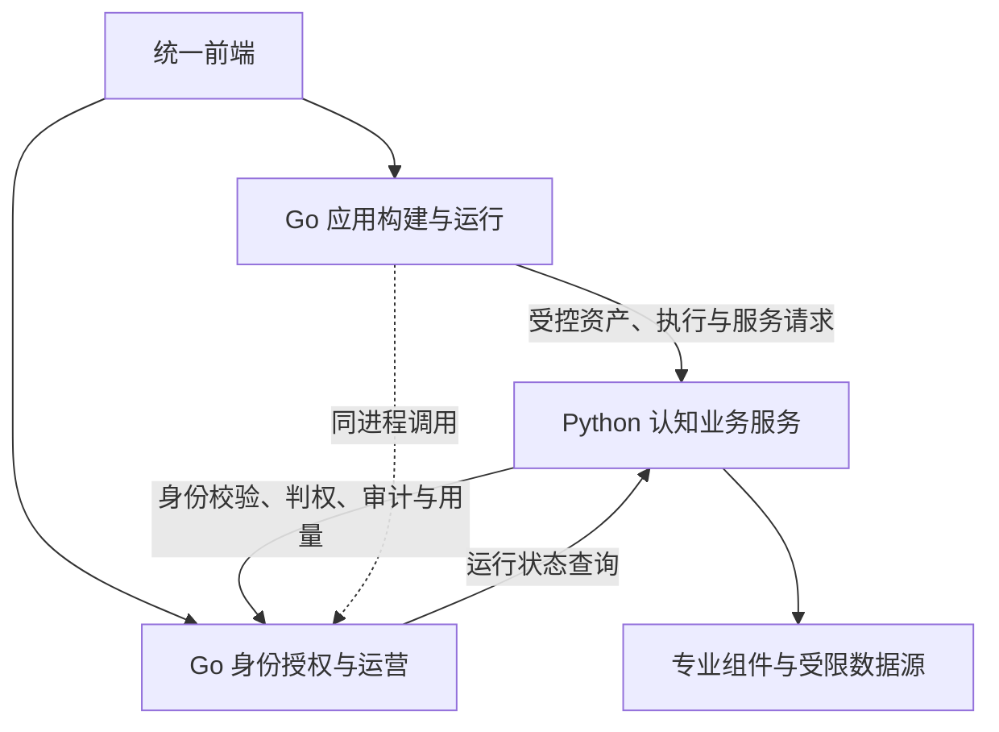
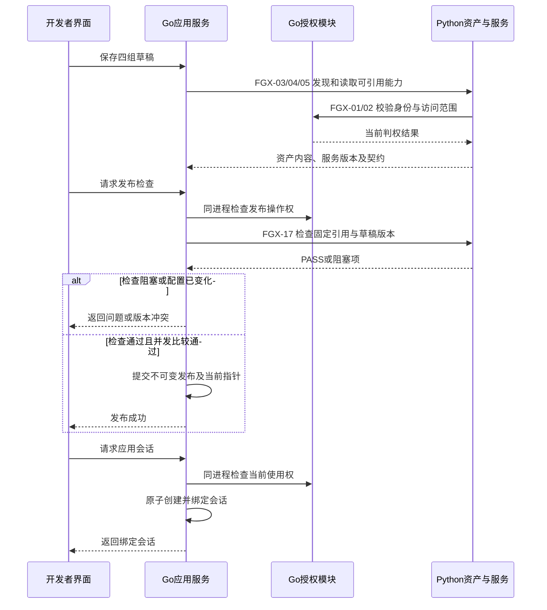
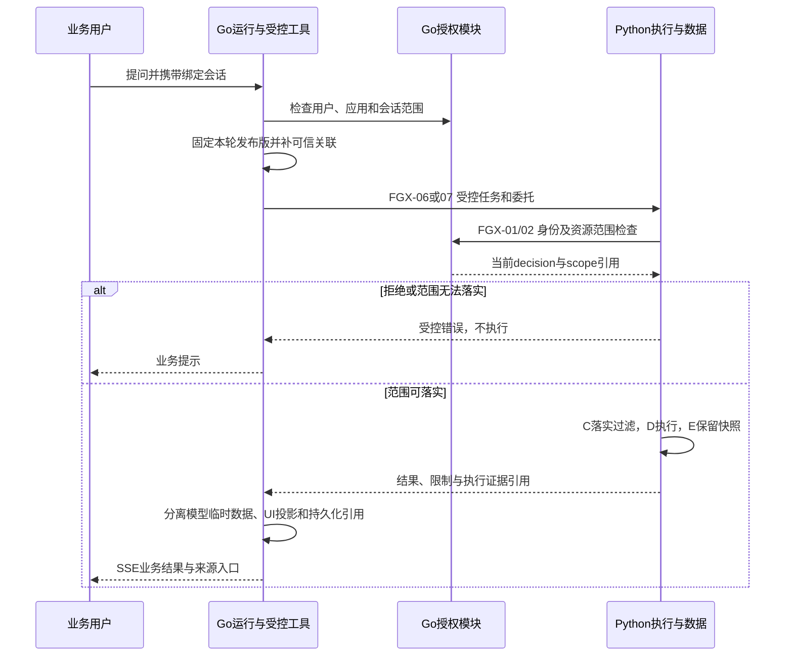
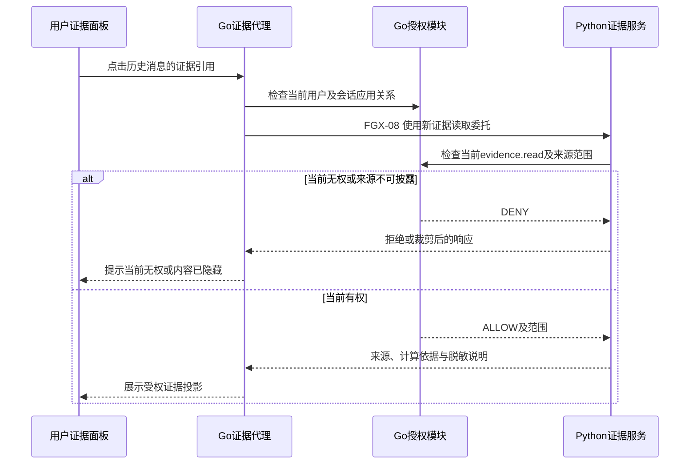
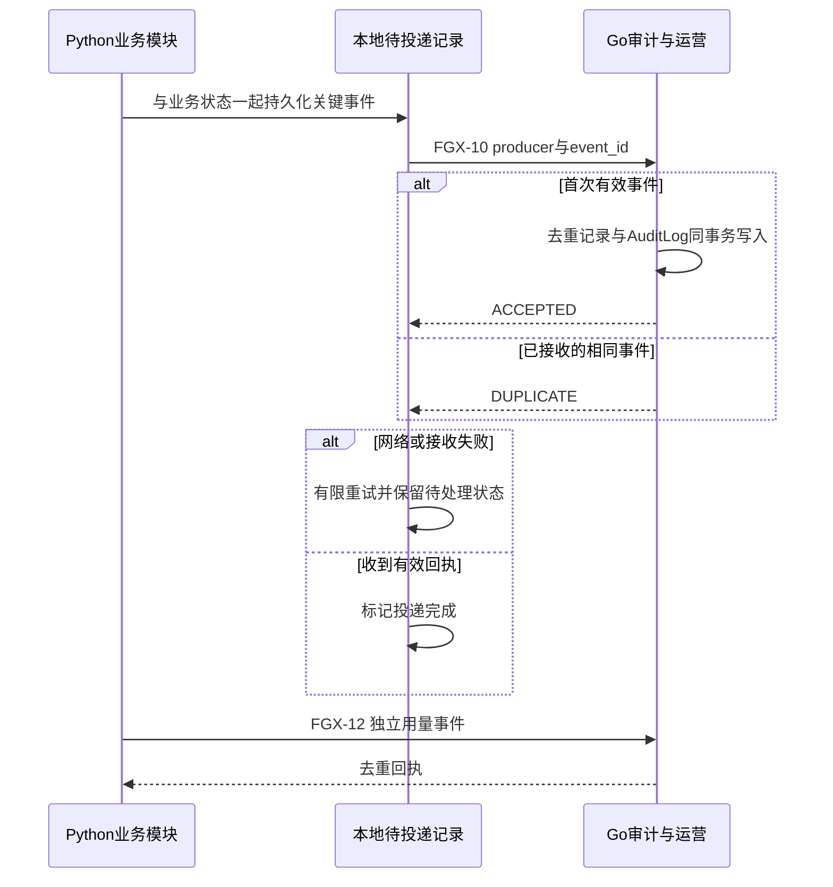
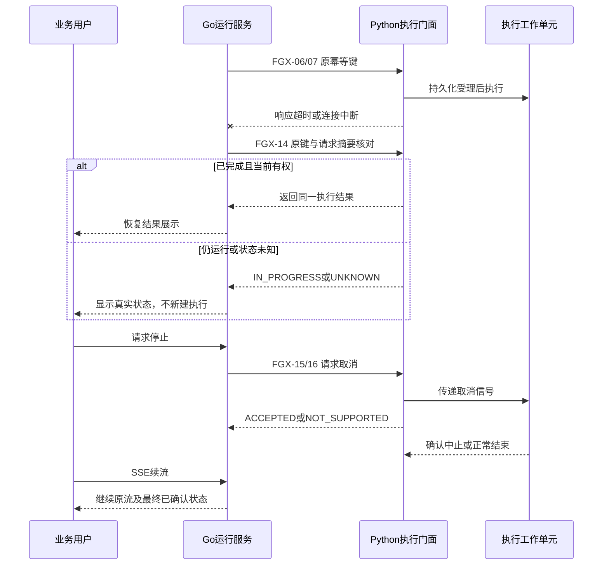
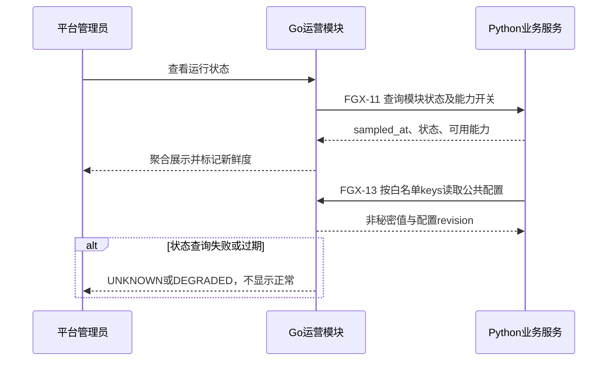

# Cognara：F/G 与 A—E API接口及交互流程

V0.3｜2026-11-15｜工程协作草案，替代V0.2作为当前接入设计

本文用于F/G负责人和A—E团队协作。模块编号只用于架构追踪，真实UI使用“应用、资产、服务、身份与权限”等业务名称。本文不是已部署API清单，也不表示Figma图稿已变成实现。

## 1. 本轮变化与固定边界

| 项目 | 当前约定 |
|---|---|
| 产品品牌 | Cognara / Enterprise Cognitive Platform |
| 前端 | 一个Vue/TypeScript/TDesign工程：frontend/，部署为platform-web |
| F/G后端 | 一个Go主服务：backend/platform/，部署为platform-api；沿用WeKnora运行、身份与审计实现并扩展 |
| A—E后端 | 一个Python业务服务：backend/cognition/，部署为cognition-api；局部复用Semantica专业组件 |
| 数据权威 | F应用发布/绑定，G身份授权/审计/运营；A资产身份，B专业定义，C资源与实际过滤，D执行证据，E服务定义/注册/渠道 |
| Python排除范围 | 排除WeKnora的Python DocReader及未获准Python沙箱，不删除A—E Python业务服务 |
| 内部API | 沿用13个核心操作，补充5个按能力开关启用的提案，共18个；详细Schema见配套OpenAPI |
| 浏览器API | 复用已有聊天等路由；平台应用管理、选择器和证据代理为新增提案，不与18个内部操作混算 |
| 首期运行 | 同租户、已验证在线用户；后台Agent、跨租户、IM、Embed分别验证后再启用 |
| 执行子集 | 直接执行只形式化BASIC_METRIC与BASIC_RULE；其他能力在专业载荷与数据范围协议完成前拒绝 |

不新增全局BFF、第二套会话平台或按A—G拆出的七个微服务。G1/G2/G4目前是Go进程内模块；跨后端才产生网络调用。

源码基线沿用WeKnora `cbdcebabf48c5ee2d6868b370326aa8341703f62`、Semantica `1e14db0af8d78890b9a1513b49bef264cbb59e9b`，不声称本轮更新到最新main。本轮重新读取前者的routes_chat.go、container.go、knowledge_process.go，复核聊天、停止/续流以及DocReader依赖；其余源码事实继承V0.2核查记录。新增内部接口均需双方实现。

## 2. 调用边界与团队职责



| 边界 | 提供方 | 使用方 | 责任 |
|---|---|---|---|
| 可见资产与正式上下文 | A；内容由B/C提供 | F选择器和受控工具 | 不复制一套资产目录；披露和内容读取分别判权 |
| 服务发现与调用 | E | F配置及运行 | 内部开放渠道、固定服务版本和输入输出契约 |
| 直接执行与证据 | D | F运行及证据面板 | 返回执行ID、实际依赖与受权投影；完整证据留D |
| 实际数据读取 | C | D/E及获准资源预览 | 真实落实行、列、图、文档范围；不能只判断布尔ALLOW |
| 业务知识、模型与规则 | B | A/D/E | F不写B专业定义，不把LLM输出当正式规则 |
| 身份、授权与委托 | G1 | F及A—E | 真实用户与应用双身份、租户/受众/用途绑定、撤销 |
| 审计与基础用量 | G2/G4 | A—E与F | 事件去重、关联请求、有限补偿，不保存完整业务结果 |
| 运行状态与公共配置 | Python聚合/G4 | G4/Python | 非秘密配置、采样时间和未知/降级状态 |

C1实现可暂留Go宿主以复用知识库与RAG，业务资源身份仍由C1统一。若采用此模式，C1门面调用Go适配器；不得让Go与Python各维护一套独立Document ID。F通常通过A/D/E使用B/C，不直接调用其专业CRUD。

## 3. 通用协议与身份规则

### 3.1 请求头

| 字段 | 规则 |
|---|---|
| Authorization: Bearer | 服务间凭据，证明调用服务；具体发行/轮换机制仍待选型 |
| X-Delegation-Token | 受保护业务调用必需；从Go受信上下文产生，绑定真实用户、应用、租户、用途和受众；不得来自LLM参数 |
| X-Request-ID | 每个HTTP请求必填；重试产生新request_id，但保留同一个业务调用幂等键 |
| traceparent | 可选链路追踪；不能作为身份或权限依据 |
| Idempotency-Key | 执行、服务执行、取消和事件写入必填；同一业务调用保持稳定，禁止随机换键重试 |

事件接收、运行状态和公共配置使用服务身份，不能因为无在线用户而伪造真人。回调G时，委托放X-Delegation-Token，不能当作G登录Bearer；G检查委托原受众、用途与调用服务。

V0.3收紧：直接执行必须提供preconditions.context_receipt；在线应用运行身份必须显式绑定application_id、application_release_id和turn_id。V0.2调用方需同步更新，不能仅替换文档而保持旧载荷。

线协议tenant_id使用十进制字符串，并校验uint64范围。其他ID分别使用app_id、asset_id、resource_id、service_id、session_id、release_id、execution_id，不能互换。时间采用UTC RFC3339；精确Decimal采用字符串并携带类型/单位；禁止NaN与Infinity。

### 3.2 授权与数据范围

- 用户直接读资产：验证用户对该资产内容的直接访问权。
- 用户通过应用运行：验证用户的应用使用权、应用的资源/服务调用权、用户的实际数据范围；不要求用户另行取得所有底层资源的直接访问权。
- 后台Agent：只有明确支持独立机器授权时允许；actor_user_id为空，不能填创建者冒充真人。
- G返回decision_id、policy_revision及scope_ref；C解析并执行范围约束。无法解析、过期或无法实现的范围必须拒绝。
- 范围表达、解析位置和绑定校验由G/C共同冻结，当前仍是实施阻塞项，不把一个scope_ref字符串当作安全已经实现。
- Go→Python→Go的授权回调不能持有跨网络数据库事务锁；不得把ALLOW缓存为跨Turn永久许可。

### 3.3 业务状态

D/E结果状态仍为SUCCESS、EMPTY、PARTIAL、FAILED。PARTIAL必须带原因；HTTP 200不等于业务成功。ACCEPTED只表示取消请求受理，不表示已经中止。执行恢复接口的CANCELED状态与原结果状态区分，不私自给旧Schema添加同义枚举。

## 4. 内部API目录：18个操作

所有路径为**拟议服务间API**，不是已经存在的上游路由。前13个保持V0.2路径；后5个为本轮新增能力提案。内部路径不直接暴露给浏览器。

| ID | 提供方 | 方法与路径 | 核心输入 → 输出 |
|---|---|---|---|
| FGX-01 | Go G1 | POST /internal/v1/identity/introspect | audience、purpose → active、可信principal_context |
| FGX-02 | Go G1 | POST /internal/v1/authorization/check | action、resource、context → ALLOW/DENY、decision_id、范围引用 |
| FGX-03 | Python A | POST /internal/v1/assets/discover | 类型、检索词、cursor → 获权资产摘要及next_cursor |
| FGX-04 | Python A | POST /internal/v1/assets/context | asset_refs、level → 正式内容、实际版本、就绪状态、context_receipt |
| FGX-05 | Python E | POST /internal/v1/services/discover | INTERNAL_APPLICATION渠道、检索词 → 服务版本及I/O Schema |
| FGX-06 | Python D | POST /internal/v1/executions | 正式资产引用、受限任务、前置凭据、关联 → 执行结果、实际依赖、证据引用 |
| FGX-07 | Python E | POST /internal/v1/service-executions | service_id/version、arguments、关联 → 服务结果、快照引用与子执行引用 |
| FGX-08 | Python D | GET /internal/v1/executions/{id}/evidence | 执行ID与当前授权 → 经裁剪的来源和计算依据 |
| FGX-09 | Python E | GET /internal/v1/service-executions/{id} | 服务执行ID与当前授权 → 已完成服务执行概要和子执行引用 |
| FGX-10 | Go G2 | POST /internal/v1/audit-events | producer/event_id、主体、对象、结果、关联 → ACCEPTED/DUPLICATE |
| FGX-11 | Python聚合 | GET /internal/v1/operations/status | 服务身份 → 采样时间、模块状态、可选能力开关 |
| FGX-12 | Go G4 | POST /internal/v1/usage-events | event_id、对象、单位、数量 → 去重回执 |
| FGX-13 | Go G4 | POST /internal/v1/config/resolve | 允许的keys、已知revision → 非秘密values与revision |
| FGX-14 新 | Python D/E恢复门面 | POST /internal/v1/execution-requests/lookup | operation、原幂等键、请求摘要 → 受权状态和可恢复结果 |
| FGX-15 新 | Python D | POST /internal/v1/executions/{id}/cancel | 执行ID、取消原因、幂等键 → 受理/已中止/已结束/不支持 |
| FGX-16 新 | Python E | POST /internal/v1/service-executions/{id}/cancel | 服务执行ID、原因 → 服务级取消状态；由E传播到子执行 |
| FGX-17 新 | Python A/E引用门面 | POST /internal/v1/references/validate | 固定资产/服务引用、draft_revision → PASS/BLOCKED、检查凭据和有效期 |
| FGX-18 新 | Python C1门面 | GET /internal/v1/resources/{id}/content-projection | 资源ID、当前范围 → 有界文本预览、来源定位、脱敏说明 |

FGX-14/17采用同一Python业务服务中的薄门面，协调已有模块；不是新增部署服务。FGX-18是可选资源预览，不是重新引入DocReader、文档上传或完整知识库接口。嵌入、解析与原文件下载另行约定；不能拿预览响应代替完整解析链路。

FGX-11的integration_capabilities用于协商REFERENCE_VALIDATION、ATOMIC_IDEMPOTENCY_LOOKUP、EXECUTION_CANCEL、SERVICE_EXECUTION_CANCEL、RESOURCE_PROJECTION。缺少能力声明按不支持处理。FGX-17未实现时发布链路必须采用已验证的等效逐项检查，不能直接PASS；其余可选能力未实现时不展示可用入口。

## 5. F控制面、运行与证据接口

以下浏览器→Go路径为设计建议，不包含在18个内部操作中。保留既有Agent接口作为草稿来源，不能让它成为第二套应用发布权威。

| 状态 | 方法与路径 | 处理 |
|---|---|---|
| 新增 | GET/POST /api/v1/cognitive/apps | 使用门户与管理列表按权限/用途过滤；创建平台应用并绑定Agent草稿 |
| 新增 | GET/PUT /api/v1/cognitive/apps/{app_id} | 返回详情或更新四组草稿；校验draft_revision，冲突409 |
| 新增 | POST /api/v1/cognitive/apps/{app_id}/release-checks | 调A/E检查引用、检查发布权；返回check_id、草稿版本和阻塞项 |
| 新增 | POST /api/v1/cognitive/apps/{app_id}/releases | check_id、expected_draft_revision、expected_current_release_id → 不可变发布和新指针 |
| 新增 | GET /api/v1/cognitive/apps/{app_id}/releases | 只读发布历史；不默认增加回滚/撤回动作 |
| 新增 | POST /api/v1/cognitive/apps/{app_id}/sessions | Go事务中复用SessionService创建会话并绑定app及owner |
| 新增 | GET /api/v1/cognitive/selectors/assets | 将浏览器筛选适配为FGX-03；无权内容不因目录可见而返回 |
| 新增 | GET /api/v1/cognitive/selectors/services | 将筛选适配为FGX-05；仅展示内部开放且可引用版本 |
| 新增 | GET /api/v1/cognitive/evidence/{execution_id} | 从Go校验会话/app/Turn及当前证据权限，再代理FGX-08 |
| 已有需改造 | POST /api/v1/agent-chat/{session_id} | 保留WeKnora消息/引擎/SSE链路；服务端取绑定app和当轮release |
| 已有需改造 | GET /api/v1/sessions/continue-stream/{session_id} | 恢复原流，不重新启动执行 |
| 已有需改造 | GET /api/v1/messages/{session_id}/load | 同时检查owner、app、当前权限；只读历史引用 |
| 已有需改造 | POST /api/v1/sessions/{session_id}/stop | 请求停止生成；是否中止远端D/E由取消协议确认 |

所有Session列表、详情、发送、历史、续流、停止、删除均要检查绑定；fork/rewind未实现完整绑定前禁用。企业应用会话不得改走普通knowledge-chat绕过能力限制。

发布事务先验证检查凭据与当前草稿一致，网络检查完成后再做短事务和并发比较；不把远端校验与本地数据库当成分布式原子事务。引用可能在发布后失效，因此运行仍需重新检查。既有会话**下一Turn使用当前发布指针**；已开始Turn固定所取release，不在执行中途切换。

Go到D/E的四个工具继续为cognitive_discover_assets、cognitive_get_asset_context、cognitive_execute、cognitive_call_service。保持原Tool接口与SSE消息，不另造模型工具协议。显式allowlist；nil不得意外启用上游默认全集。

### 5.1 直接执行样例

模型只提交业务参数；不接受租户、用户、应用、服务URL、release或任意SQL/程序。以下关联和前置字段由Go补充：

```json
{
  "capability_type": "BASIC_METRIC",
  "target": {"asset_id": "asset_demo"},
  "payload": {"parameters": {"period": "2026-10"}, "dimensions": ["warehouse"], "filters": []},
  "preconditions": {"context_receipt": "context_demo"},
  "execution_options": {"max_rows": 100},
  "correlation_context": {
    "turn_id": "turn_demo", "application_release_id": "release_demo",
    "assistant_message_id": "message_demo", "tool_call_id": "call_demo"
  }
}
```

D检查目标在发布允许引用中、正式定义有效、参数符合专业定义、receipt与主体/目标匹配，并执行当前数据范围。指标/规则未就绪时拒绝，不临时聚合或执行LLM生成规则绕过。服务arguments必须符合所选版本的input_schema；不能因JSON结构合法便允许调用。

### 5.2 发布前引用检查样例

```json
{
  "references": [
    {"kind":"ASSET","id":"asset_demo","version":"v1"},
    {"kind":"SERVICE","id":"svc_demo","version":"v1","contract_revision":"contract_demo"}
  ],
  "draft_revision":"draft_3",
  "purpose":"APPLICATION_RELEASE"
}
```

返回validation_id、draft_revision、valid_until、status及逐项状态。服务端绑定真实主体、租户、完整引用及配置版本。PASS要求所有引用VALID；凭据不是永久授权或资源预留。若服务版本在渠道下线，不能退回“最新服务”或任意历史版本。

## 6. 交互时序与泳道

### 6.1 配置、发布与会话建立



### 6.2 一轮业务调用



E内部步骤共用一次解析的正式兼容快照；固定有限步骤默认Fail-fast。E到D/C的委托需要保留真实用户和应用身份，并限制用途/资源，不用全权服务Key代替用户范围。

### 6.3 历史结果与证据读取



历史答案不自动授权完整证据。过期Turn委托不得拿来读取证据，Go需建立新的evidence_read上下文。历史消息中的敏感数据与源权限变更后的展示/留存策略，仍须G/D/F共同冻结；禁止只保护新证据而默认所有旧持久化内容永久可见。

### 6.4 审计和基础用量



本地待投递记录是新增建议，不要求引入消息总线。producer必须与服务身份允许的来源匹配；去重键为租户/producer/event_id，绑定内容摘要，同键不同内容返回409。审计与用量各自去重，不能把一条成功调用的所有层都重复计费；当前仅做运营用量，不定义账单。

### 6.5 超时恢复、续流与取消



NOT_FOUND不等于一定没执行。仅提供方已实现持久化原子幂等受理、同键摘要检查并明确safe_to_resubmit_same_key=true时，才允许同键重提交；不换新键。权限已撤销后不借恢复接口继续披露结果。取消不支持时只能停止后续生成并告知执行未必终止；不误报“已取消”。

### 6.6 运行状态与配置读取



Go模型、MCP、存储等14个支撑配置子视图优先复用上游管理API，不全部变成跨服务接口。G公共配置不覆盖B专业定义、C数据源配置或E服务定义；API Key不是用户委托。

## 7. 错误、版本、可靠性与输出保护

| 情况 | 协议与行为 |
|---|---|
| 结构非法 | 400 INVALID_REQUEST；身份/URL/任意代码字段不得进入模型工具参数 |
| 身份失效 | 401 AUTHENTICATION_REQUIRED；不切匿名或高权机器身份 |
| 无权 | 403 AUTHORIZATION_DENIED；存在性敏感场景按约定统一不可用响应 |
| 对象不可见或不存在 | 404 ASSET_UNAVAILABLE；不披露对象内部属性 |
| 版本或幂等冲突 | 409 VERSION_INCOMPATIBLE/IDEMPOTENCY_CONFLICT；不得静默改版本 |
| 限流 | 429 RESOURCE_LIMIT_EXCEEDED；保留同一业务调用关联 |
| 能力未实现或依赖缺失 | 503 CAPABILITY_UNAVAILABLE；不以空结果、Mock或提示词绕过 |
| 远端超时 | 504 EXECUTION_TIMEOUT；结果可能未知，按原键核对 |
| 不支持取消 | 业务NOT_SUPPORTED或明确受控错误；UI不声称已中止 |
| 部分成功 | PARTIAL及原因；保留已有执行引用，不能伪装完整成功 |

context_receipt、validation_id、scope_ref、release_id与snapshot_ref各自有不同权威，不得互换。发布快照固定能力引用，不冻结动态业务数据；as_of/数据快照需具体服务定义支持，不能由F假定所有调用自动使用同一数据时点。

D/E完整业务结果只在必要运行内存中提供给模型。ToolResult.Data、SSE和AgentSteps只存获权小投影及引用；Output同样需清理，防止通过文本结果持久化整表。委托、凭据和原始秘密不能进入模型、日志、历史或证据链接URL。

G2只保存关键事件和关联，完整执行证据由D3掌握。Python业务与Go审计不能构成单事务：关键写操作必须有可靠事件保护，未完成前不得承诺生产就绪。只读执行的审计失败也需可查并补偿，不能将授权拒绝改成允许。

## 8. 排除DocReader后的资源交互

已复核：Go容器装配仍注册initDocReaderClient，文档处理仍通过resolveDocReader与callDocReaderWithTimeout。排除Python容器不自动消除这些调用点。

实施选择必须明确：①由C1提供替代解析适配，并满足Document/Chunk/来源定位、错误和权限契约；或②暂时禁用受影响的上传、解析、附件及相关检索入口。不能只隐藏配置页而让后台队列继续调用不存在的服务。

B1 TTL导入是语义模型专业入口，不经通用DocReader，不应随文档解析一起删除。已有已验证索引能否继续检索取决于实际存储与权限，不把“新文档不能解析”等同于“所有检索必须停止”。FGX-18只提供当前可访问内容的有界投影。

## 9. 软件接入点与分工

| 负责人 | 目录或接入点 | 交付 |
|---|---|---|
| F/G负责人 | backend/platform/internal/platform/applications | 应用对象、不可变发布、会话绑定、Turn引用 |
| F/G负责人 | internal/platform/connectors/cognitive | Go HTTP客户端、认证/委托、超时、状态映射；无未知执行盲重试 |
| F/G负责人 | internal/platform/governance | 授权/委托、审计接收去重、公共运营聚合 |
| F/G负责人 | 原qa.go、session_agent_qa.go、context_clone.go | 受信发布上下文进入异步Agent链；不覆盖原Caller/Principal |
| F/G负责人 | 原tools定义/目录/allowlist/注册/persist及前端chat | 四个受控工具、结果卡与证据入口；显式投影 |
| A—E团队 | backend/cognition对应模块 | 资产上下文、正式定义、实际数据过滤、执行证据和服务快照 |
| 共同维护 | contracts及C1复用门面 | Schema、版本兼容、范围、错误、幂等、解析替代与样例 |

新增Go扩展必须在既有module内部，不从平级Go模块非法import internal包。业务代码复用WeKnora但目标目录不保留品牌名；源文件版权和来源仍保留。禁止Go/Python直接写对方权威表或共同运行一套迁移。

## 10. 联调顺序与验收

1. 共同确认现有13操作与5个补充提案、服务认证、scope表达和两类正式执行载荷。
2. 先跑通在线用户→绑定应用→BASIC_METRIC→受限数据源→证据引用→SSE与历史。
3. 验证用户有应用使用权但无底层直访权的合法场景，以及跨应用/跨租户/撤权拒绝。
4. 验证草稿变更不影响线上、下一Turn读取新发布、运行中Turn不换版本、引用失效拒绝。
5. 验证发现/上下文/执行/证据各自判权，C真正过滤行列、图和文档；不支持范围则拒绝。
6. 验证HTTP200业务FAILED、PARTIAL、EMPTY正确映射，敏感结果和Token不进入持久化。
7. 故障注入：业务成功但响应超时、审计回执丢失、重复事件、同键不同载荷、取消不支持和取消晚到。
8. 验证旧DocReader未启动时无后台误调用；替代解析缺失有明确不可用提示。
9. 回归WeKnora原登录、普通Agent、会话、SSE和审计；平台模式不得从旧兼容分支绕过。

未决阻塞：服务凭据方案及委托TTL/撤销；G/C范围协议；引用兼容与原子快照规则；审计可靠性；执行原子幂等受理与取消；C1替代解析。F3完整撤回/回滚、G3、通用Workflow、长期记忆仍不自动纳入。

配套包含OpenAPI 3.1 JSON、18份正向样例、负向校验脚本、7张Mermaid图源码及固定提交来源记录。校验只验证结构、引用、样例和指定规则，不代表API已部署、Go/Python已构建、真实授权或端到端已通过。Mermaid源码另附，未声称已完成渲染验证。

## 附录：关键真实源码

- [会话、聊天、停止与续流路由](https://github.com/Jacksonhuf/WeKnora/blob/cbdcebabf48c5ee2d6868b370326aa8341703f62/internal/router/routes_chat.go)
- [Go依赖装配与DocReader客户端](https://github.com/Jacksonhuf/WeKnora/blob/cbdcebabf48c5ee2d6868b370326aa8341703f62/internal/container/container.go)
- [文档处理与解析调用](https://github.com/Jacksonhuf/WeKnora/blob/cbdcebabf48c5ee2d6868b370326aa8341703f62/internal/application/service/knowledge_process.go)
- [Agent运行配置](https://github.com/Jacksonhuf/WeKnora/blob/cbdcebabf48c5ee2d6868b370326aa8341703f62/internal/application/service/session_agent_qa.go)
- [工具目录与注册](https://github.com/Jacksonhuf/WeKnora/blob/cbdcebabf48c5ee2d6868b370326aa8341703f62/internal/application/service/agent_service.go)
- [工具结果投影与持久化](https://github.com/Jacksonhuf/WeKnora/blob/cbdcebabf48c5ee2d6868b370326aa8341703f62/internal/agent/tools/persist.go)
- [Semantica专业服务源码](https://github.com/Jacksonhuf/semantica/blob/1e14db0af8d78890b9a1513b49bef264cbb59e9b/semantica/server.py)

Semantica的Explorer共享API Key、图会话和stdio MCP不直接等同平台多租户业务服务；其SPARQL路径不等同Ontop；PolicyEngine不代替G1。继续按V0.2记录的薄封装与边界改造，不将上游能力名称改名后当作接入完成。

### 对话历史兼容扩展（第七轮）

消息读取`GET /api/v1/messages/{session_id}/load`新增可选`before_message_id`，与`before_time`互斥，仅接受本会话的消息ID。保留`success/data`，增加`has_more: boolean`及`next_before_message_id: string|null`。默认20条，`limit`限定1–200；无效游标/时间/数量400。`before_time`按真实时间比较，ID游标按保存顺序向前读取，继续执行现有授权与脱敏。

会话详情可加`include_messages=false`，只读元数据，不在详情响应中加载历史，默认行为保持。会话目录`GET /api/v1/sessions?app_id=...`校验当前应用使用权，缺app_id返回400，无权403，其他企业应用404。

### 授权写入兼容语义（第八轮）

创建授权仍返回200与原Grant结构；同企业、主体类型/ID、资源类型/ID、操作和范围均相同的有效授权，在事务内复用原grant_id，不重复写authorization.grant事件。主体和资源归属在同一事务内复核。重复撤销本企业已撤销记录成功但不重复写authorization.revoke事件；撤销后重新授权创建新记录并保留历史。现存重复记录不自动合并。

### 目录分页与版本约束（第九轮）

GET /api/v1/cognitive/selectors/assets和/selectors/services接受既有query、cursor、limit。代理按v0.3转发到内部发现接口：query至多256字符，cursor至多2048字符，limit为1–100；无效参数400且不请求上游。服务channel由平台固定为INTERNAL_APPLICATION，cursor保持不透明。

应用service_refs仍为原结构，但同一service_id只能出现一次，保存草稿或发布检查发现重复返回400 INVALID_REQUEST。选择不同版本需显式替换原版本，不改变其他服务引用。此约束与受控服务工具按service_id查找发布引用的既有执行方式一致。

### 治理列表检索与分页（第十轮）

GET /api/v1/cognitive/governance/{audit|exceptions|usage|grants}新增query、limit、cursor，默认20条，最大100条，next_cursor为末页null或下一页不透明定位游标。每次读取仍检查管理员与企业归属；游标绑定企业/列表/筛选条件，不作为授权依据。

audit支持outcome，exceptions/grants支持各自status，usage支持unit；除grants外支持RFC3339格式的from_time/to_time（包含边界）。query最长256字符，范围或筛选无效、条件改变后复用游标、定位项不再匹配时400；需刷新重新读取。搜索包含request_id及执行/用户/应用/资源标识，结果按接收顺序由新到旧，不提供跨单位汇总。原全量响应改为分页后，调用方需继续消费next_cursor。

### 配置版本与隔离（第十一轮）

GET /api/v1/cognitive/settings/{section}新增revision。PUT原values结构保留，新增可选expected_revision；产品UI必传，冲突409 VERSION_INCOMPATIBLE并保持原配置。成功返回values/revision；省略版本的旧客户端仍可写但不受并发保护。

profile只接收display_name，general只接收language/timezone/density，public只接收notice；其他分区仍只读。配置按企业/个人范围隔离，旧公共键仅企业42可回读，旧个人键需验证账户企业归属，首次保存写入新键；实际写入及审计同事务，新版本不因值改回而复用。/me.name可使用显示名称，身份ID、企业、角色和范围不变。

### 应用编辑与发布确认（第十二轮）

草稿PUT继续提交点击时快照与expected_draft_revision；成功审计application.draft.save与草稿版本同事务提交。客户端保存期间新增的修改保留为未保存状态。

发布检查继续使用check_id、draft_revision、valid_until；客户端绑定本地快照和expected_current_release_id，过期或本地配置变化后要求重新检查。POST发布仍由服务端校验所有者、当前版本、当前发布与期限。客户端不能把网络失败解释为未提交，不自动重复发布，需核对服务端历史。没有新增接口或字段。

## 对话历史管理补充（2026-11-16）

以下是F/G前后端接口增量，不新增A–E调用。

| 方法与路径 | 参数 | 返回与约束 |
| --- | --- | --- |
| `GET /api/v1/sessions` | `app_id`必填；`query`可选，去空格、不区分大小写标题子串，最多256字符；`limit`默认20、1–100整数；`cursor`可选 | `{items,next_cursor}`；只返回当前租户、当前用户、指定可用应用的会话元数据，messages=null。按最近活动降序，同时间按session_id降序。终页next_cursor=null。上述参数不可重复。 |
| `PUT /api/v1/sessions/{id}` | JSON `{title,expected_revision}`均必填；标题trim后1–80 Unicode字符 | 返回会话元数据；版本冲突409；无权应用403；非本人/跨租户404。标题、随机新版本、自定义标题标记与session.rename审计同事务提交；真正无变化不写新版本/审计。 |
| `POST /api/v1/cognitive/apps/{app_id}/sessions` | 既有可选title，trim后最多80字符 | 空标题默认“新对话”；自定义标题受保护；新增created_at/updated_at/revision元数据。 |
| `GET /api/v1/sessions/{id}` | 既有include_messages=false支持保留 | session新增revision与可用的活动时间；旧记录不伪造创建时间，最近活动从有效消息时间回填到响应；旧标题派生确定性初始版本。 |

游标绑定租户、用户、应用、规范化query与过滤后元数据快照，不是授权凭据；每次请求重新检查权限。列表在翻页前发生标题、活动或成员变化时返回400并提示刷新，客户端保留已显示页且不自动拼接新快照。游标不保证历史快照可持续读取。limit可变更。历史标题不包含消息内容搜索。

首次聊天仅在默认标题且非自定义时生成标题并变更revision；后续消息追加只更新updated_at，不引起重命名冲突。用户已改标题不会被首次聊天覆盖。重命名冲突保留输入，关闭窗口并刷新列表、重新打开后才能保存；不会自动覆盖服务端。


## 数据库选型补充（2026-11-16）

F/G生产关系数据库确定采用MySQL，与A—E技术选型统一。现有前后端及跨服务HTTP路由、参数、身份/委托、资源权威及事件幂等语义不变。双方独立逻辑库、账号与迁移所有权；不以共享表/跨库直连替代契约。本次不新增MySQL运行接口，现有PostgreSQL验证实现也不等于MySQL已接入。目标与验收见[数据库选型决议](../architecture/fg-database-decision.md)。

## MySQL v2审计查询实现补充（2026-11-16）

GET /api/v1/cognitive/governance/audit的参数、错误信封、游标及返回结构不变。MySQL v2改为租户/sequence_no范围分批读取，管理员权限与历史空租户映射保持；搜索/结果/时间仍使用原Go语义。v1游标可在相同条件下用于迁移后的v2列表。新增事件不改变已定位游标之后的旧页；未知或不可访问锚点400要求刷新。稀疏筛选仍可能扫描多批，超时返回错误而非不完整成功列表。
